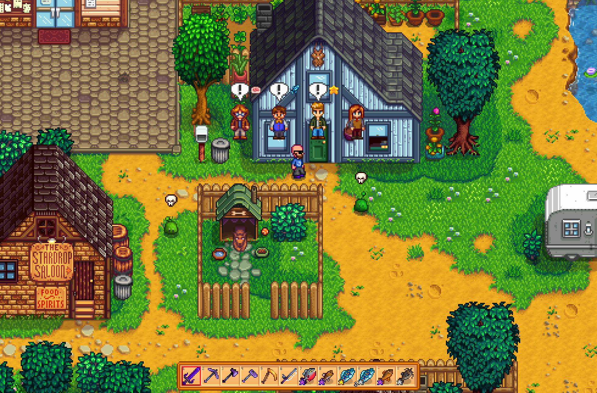
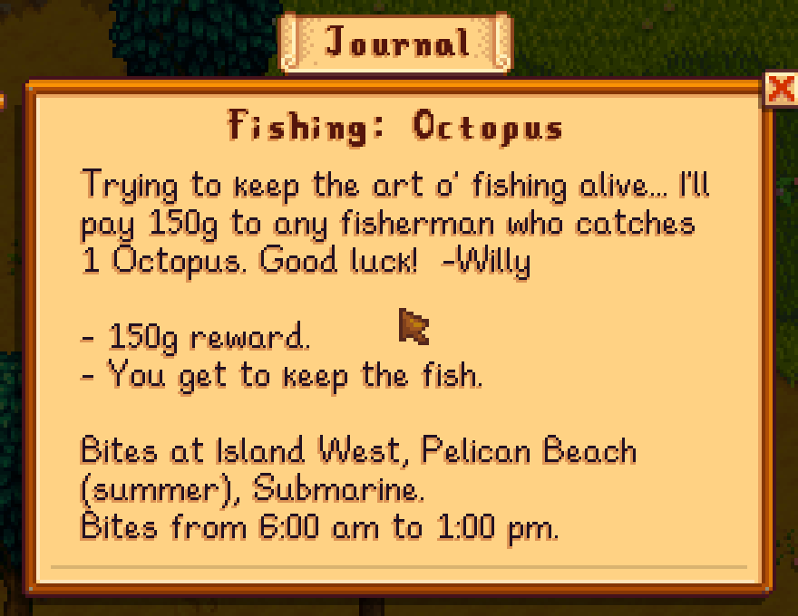
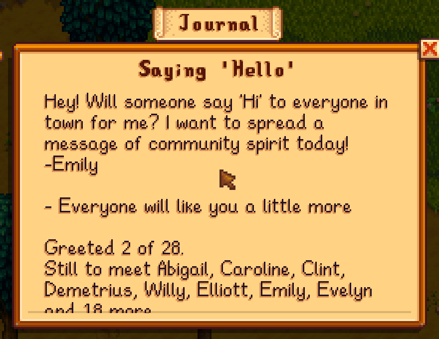
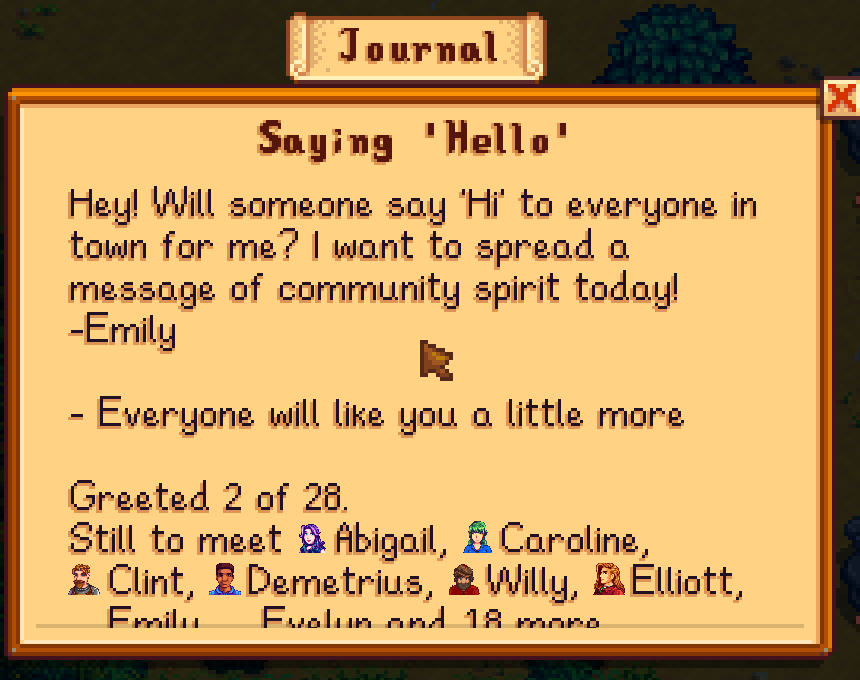
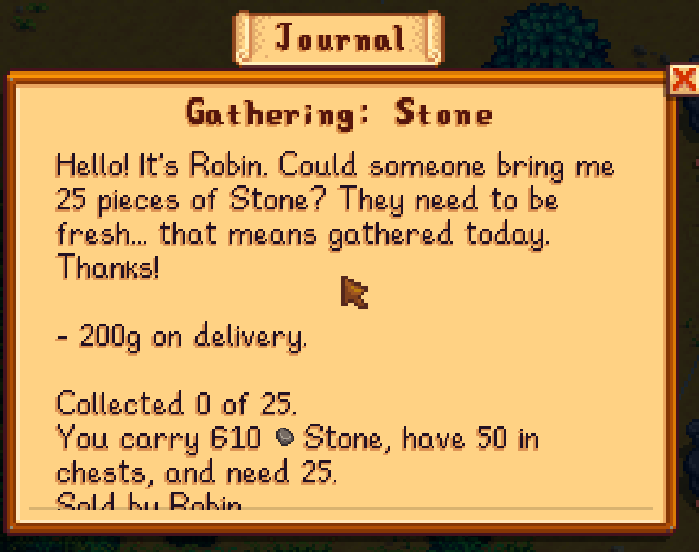
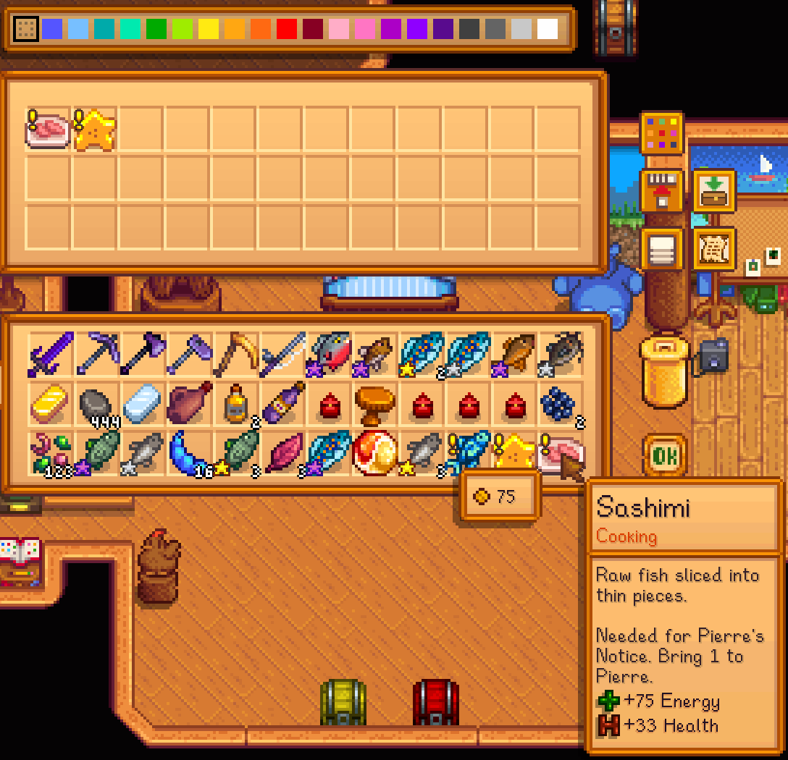
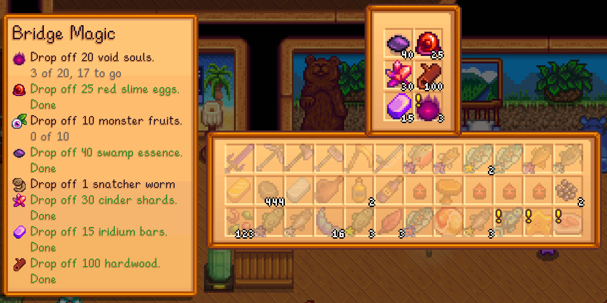
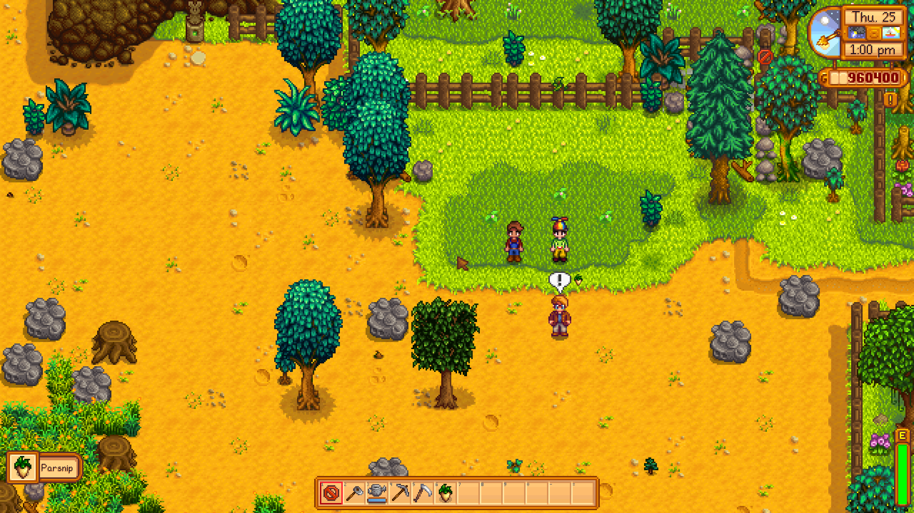
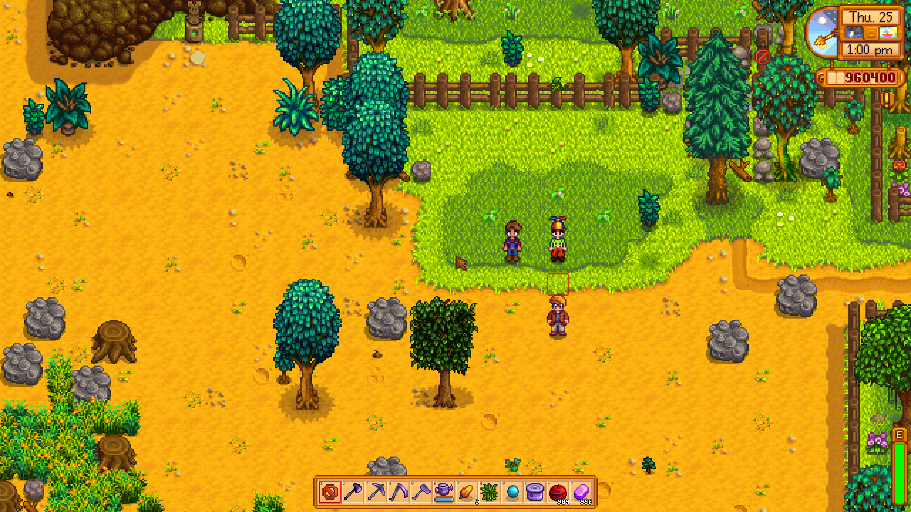

# Questie

A quest helper for Stardew Valley. It marks the people and monsters your quests need, marks the items in your backpack that a quest wants, and adds progress, where to fish, where to buy, how to make an item and who you still have to meet to the end of each quest in your journal. It uses the game's own pictures and words, so it looks like part of the game.

This is a beta (0.9.0-beta.5). It works and has been tested in the game, but it has had few players, so please report anything odd. Version 1.0 is kept for the first full release.

## What it does

**Markers over heads.** A bouncing marker, drawn with the game's own emote bubbles, shows who and what a quest needs right now.

| Marker | Meaning |
| --- | --- |
| An exclamation mark | Someone to hand something in to. For a delivery it only shows while you carry enough of the item, and the item is shown beside it. It also marks the person to go back to once a kill, fishing or gathering quest is done, and the person of a lost item quest once you have found it. |
| A speech bubble | A villager a meeting quest such as Introductions still needs you to greet. |
| A skull | A monster a kill quest asks for. The slime quest marks every slime, jelly and sludge, as the game counts them. |

**Notes in the journal.** Lines are added to the end of a quest's description, so nothing the game says is replaced.

- The villager's portrait or the item's own picture in front of each name, so who and what is easy to see at a glance.
- Progress such as "Caught 1 of 3", "Slain 2 of 5" or "Greeted 2 of 28", and how many you carry of what a delivery or gathering quest needs, with how many more lie in your chests and fridge, such as "You carry 0 Stone, have 50 in chests, and need 25."
- For a fishing quest, where the fish bites, which seasons it bites in, at what times of day and in what weather, and whether it can be caught right now, or that it is out of season. The seasons come from the rules of each place, the ones the game catches fish by, so a fish that only bites in winter says so and one that can be caught year round on Ginger Island is not called out of season. A crab pot fish says which water. This is read from the game's own fish and location data, so it also covers fish and places added by other mods.
- For a delivery or gathering quest, which shops sell the item and for how much.
- For the story quests that ask you to bring something, such as the largemouth bass for Jodi's fish casserole or the chocolate cake for Haley's cake-walk, how many you carry, where to take it, how to catch or cook it and where it is sold.
- For a building quest, who builds it and what it costs. For the quests about reaching a level in the mines or the Skull Cavern, how deep you have been.
- For an item quest, how to make the item and whether you know the recipe. When you know it, each ingredient shows how many you carry, such as "Egg (2 of 1)". When you do not, it says how to learn it, such as at 3 hearts with Emily or at Foraging level 6.
- Who is left to meet in a meeting quest, and where a person is right now (or that they are here).
- Where a lost item lies, until you find it.

**Marks on items.** An item a quest wants gets the game's own quest exclamation mark in the top left corner of its slot, in your backpack, in chests and on the toolbar, the way the quality star sits in the bottom left. Hover over it and the tooltip says which quest wants it and what to do. A delivery item is marked until you hand it in. A fish or a resource is marked until you have caught or gathered enough.

**Donation boxes.** A special order that takes donations, such as the eggs for Gus, shows what it asks for and how far you have come beside the box while it is open, so you do not have to close the box and open the journal to find out. The game keeps the count up to date as items go in and come out. Each line that asks for one item has that item's picture in front of it. The list stays clear of the box and your backpack, and says how many lines more there are when the screen has no room for all of them.

**A warning on the last day.** When a timed quest, such as a Help Wanted request, is on its last day, a message tells you as the day starts.

**A meeting quest that can be finished.** Introductions lists the villagers who exist when it starts. If a mod removes one of them, the quest can never be completed, and if a mod adds one, the quest never asks for them. When a save loads, Questie takes people who no longer exist off the list and adds sociable villagers you have not met, using the game's own rule for who counts.

## Multiplayer

Quests belong to each player, so markers and notes follow your own journal. In the same game, a farmhand sees a marker over a villager for their delivery and the host sees none.

## Install

1. Install [SMAPI](https://smapi.io/).
2. Download the zip from the [Releases page](https://github.com/Kkthnx-Stardew/Questie/releases) and unzip it into your `Mods` folder.
3. Run the game through SMAPI.

Stardew Valley 1.6.9 or newer. [Generic Mod Config Menu](https://www.nexusmods.com/stardewvalley/mods/5098) is optional and gives you the settings in the game.

## Settings

Everything is on by default. Edit `config.json` after the first run, or use Generic Mod Config Menu.

| Setting | What it does |
| --- | --- |
| `EnableMarkers` | The bouncing markers at all. |
| `MarkDeliveries` | Mark the person an item must be delivered to. |
| `OnlyWhenCarried` | Mark a delivery person only while you carry enough of the item. |
| `MarkTurnIn` | Mark the person to go back to when a quest is done. |
| `MarkSocialize` | Mark the villagers a meeting quest still needs. |
| `MarkMonsters` | Mark the monsters a kill quest asks for. |
| `ShowHints` | Add notes to the end of quests in the journal. |
| `ShowFishInfo` | Say where, when and in what weather a fish bites. |
| `ShowShops` | Say which shops sell the item a quest wants. |
| `ShowNameIcons` | Put the portrait or item picture in front of a name in the quest log. |
| `ShowRecipes` | Say how to craft or cook an item, and how to learn the recipe. |
| `ShowWhereIsNpc` | Say where a quest's person is right now. |
| `ShowItemMarks` | Mark the items a quest wants with an exclamation mark, and add a line to their tooltip. |
| `ShowDonations` | List what a special order asks for beside its donation box. |
| `WarnExpiring` | Show a message on the last day of a timed quest. |
| `FixSocializeQuests` | Repair a saved meeting quest when the villagers change. |

## Console command

`questie_report` lists the quests Questie knows how to help with, the notes it adds to each, and who and what it marks. Paste it into a bug report.

## Performance

Markers are worked out when something changes and twice a second, and drawn from a lookup, so a frame does no searching. The item marks cost one set lookup for each slot on screen. Measured in the game with five quests, working out the markers takes about a microsecond and asking for a quest's notes about a twentieth of a microsecond. The notes themselves are rebuilt at most three times a second for the quest on screen. More in [docs/PERFORMANCE.md](docs/PERFORMANCE.md).

## Works with expansions

Tried in the game with Stardew Valley Expanded 1.15.11, Ridgeside Village 2.5.17, East Scarp 3.0.9, Sunberry Village and More New Fish, among about seventy mods. Their villagers get markers, portraits and a place on a meeting quest the way the game's own do, their fish show their places and seasons, their shops and recipes are named, and their donation orders get the list beside the box, such as the Bridge Magic order. Quests those mods add that are of the game's usual kinds work like any other. Quests they add as plain story quests, such as a multi-fish brew or the Sunberry seedling, show the game's own text only.

## Limits

- It is tested on Stardew Valley 1.6.15 with SMAPI 4.5.2, alone and with one host and one joining player on one computer. Three or more players, split screen and play over the internet are untested.
- The notes are in English. The translation file is `i18n/default.json`, and other languages can be added the usual way.
- Special orders are not quests in the game's code. Their donation boxes get the list above, but their items are not marked in the backpack and they have no markers or notes in the journal.
- Fish seasons come from the game's location list. A fish that a mod limits to a season in some other way may be listed for more seasons than it bites in.
- Quest kinds from other mods that are not one of the game's own are left alone.

## How it was made

Questie was written from scratch. The behaviour of an older quest helper mod was studied to see what players need, and none of its code was used. The notes on what was reviewed are in [docs/RESEARCH.md](docs/RESEARCH.md).

## Contributing and license

Bug reports with the output of `questie_report` are the most useful thing. MIT licensed, see [LICENSE.txt](LICENSE.txt).
